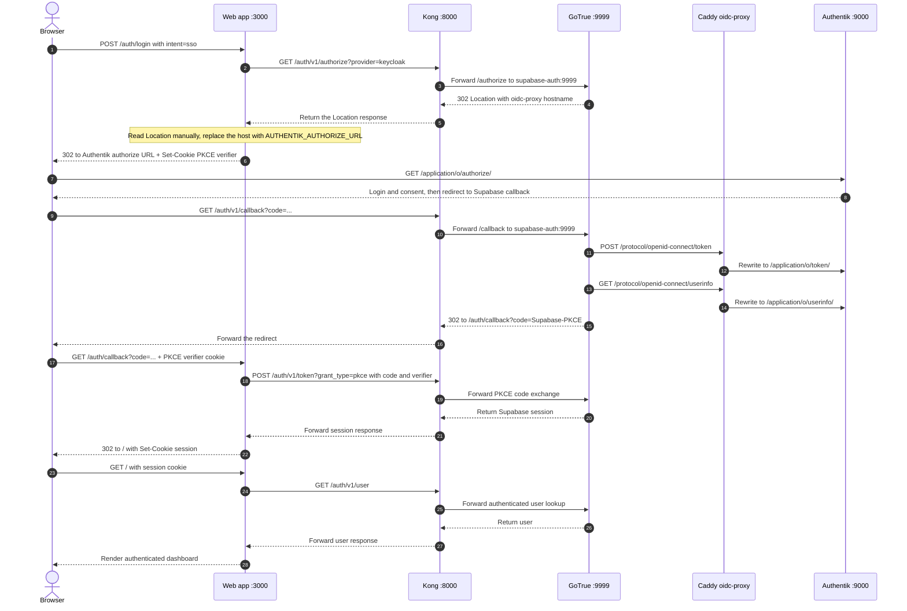

# Authentik + Supabase SSO POC

ทดสอบการเข้าสู่ระบบแบบ Single Sign-On (SSO) บนเว็บ React Router ด้วย Authentik เป็น Identity Provider (IdP) และ Supabase Auth ออก session ให้แอป ทั้งสแต็กรันผ่าน Docker Compose และมีฟอร์มอีเมลกับรหัสผ่านสำหรับทดสอบ Supabase Auth โดยตรง

PoC นี้ใช้ Authentik `2024.12.3` และ Supabase Auth (GoTrue) `v2.158.1` โดยให้ Caddy แปลง endpoint ของ provider `keycloak` ให้เป็น OpenID Connect (OIDC) endpoint ของ Authentik [ซอร์ส Keycloak provider](https://github.com/supabase/auth/blob/v2.158.1/internal/api/provider/keycloak.go#L24-L89)

> ใช้กับ local lab ค่าใน `.env.example` เป็นค่าทดสอบที่เผยแพร่ใน repo และ Compose เปิดพอร์ตบนทุก interface ของเครื่องตามค่าเริ่มต้น ให้จำกัดการเข้าถึงจากเครือข่ายและเก็บ Client Secret ใน `.env` ที่ Git ignore ไว้ [Docker port publishing](https://docs.docker.com/engine/network/port-publishing/)

> `@supabase/ssr@0.3.0` ใน lockfile ใช้ cookie adapter แบบ `get`, `set` และ `remove`; adapter ในเว็บใช้ interface นี้เพื่อเก็บ PKCE verifier และ session cookie

## เริ่มใช้งาน

ใช้ Docker พร้อมคำสั่ง `docker compose`, Git สำหรับ clone และ `curl` สำหรับเช็ก HTTP ให้พอร์ต `3000`, `5432`, `8000`, `9000` และ `9443` ว่าง Docker สร้างและรันเว็บด้วย Node.js 22 [Dockerfile](web/Dockerfile)

### 1. เปิด services

```bash
git clone <repository_url>
cd authentik-supabase-sso-poc
test -f .env || cp .env.example .env
docker compose config --quiet
docker compose up -d --build
docker compose ps
curl -fsS --retry 6 --retry-delay 2 --retry-connrefused http://localhost:8000/auth/v1/health
```

เมื่อ Supabase Auth พร้อม `/auth/v1/health` จะตอบ HTTP 200 ผ่าน Kong ส่วน Authentik ใช้เวลารัน migration และโหลด flow ครั้งแรก ให้เปิดหน้า initial setup ในขั้นถัดไปเมื่อพร้อม `depends_on` ใน Compose ชุดนี้กำหนดลำดับเริ่ม container [Docker Compose startup order](https://docs.docker.com/compose/how-tos/startup-order/)

### 2. ตั้งค่า Authentik admin

เปิด `http://localhost:9000/if/flow/initial-setup/` เมื่อเริ่มครั้งแรก ตั้งอีเมลและรหัสผ่านให้บัญชี `akadmin` แล้วเข้า **Admin interface** [Authentik Docker Compose installation](https://docs.goauthentik.io/install-config/install/docker-compose/)

### 3. สร้าง Provider และ Application

ใน **Applications → Providers → Create** เลือก **OAuth2/OpenID Provider** Provider เก็บค่าที่ Supabase Auth ใช้ยืนยันตัวตนกับ Authentik

| ช่องใน Authentik | ค่า |
| --- | --- |
| **Name** | `poc-provider` |
| **Authorization flow** | `default-provider-authorization-explicit-consent` |
| **Client type** | **Confidential** |
| **Redirect URIs/Origins (RegEx)** | เพิ่ม `http://localhost:8000/auth/v1/callback` โดยเลือก **Strict** |
| **Invalidation flow** | `default-provider-invalidation-flow` ซึ่งฟอร์มเลือกไว้ให้ |
| **Advanced protocol settings → Scopes** | เลือก mappings สำหรับ `openid`, `profile` และ `email` |

บันทึก Provider และเก็บ **Client ID** กับ **Client Secret** จากนั้นไปที่ **Applications → Applications → Create** ตั้ง **Name** เป็น `POC App`, **Slug** เป็น `poc` เพื่อให้ตรงกับ discovery และ JWKS ใน Caddy แล้วเลือก **Provider** เป็น `poc-provider` [ฟอร์มใน Authentik 2024.12.3](https://github.com/goauthentik/authentik/blob/version/2024.12.3/web/src/admin/providers/oauth2/OAuth2ProviderFormForm.ts#L120-L285)

### 4. ส่ง credentials ให้ Supabase Auth

ใส่ **Client ID** ใน `AUTHENTIK_CLIENT_ID` และ **Client Secret** ใน `AUTHENTIK_CLIENT_SECRET` ที่ไฟล์ `.env` ของ repo จากนั้นสร้าง container ของ Supabase Auth ใหม่เพื่อให้ Compose ส่งค่าชุดล่าสุดเข้าไป [Docker Compose up](https://docs.docker.com/reference/cli/docker/compose/up/)

```bash
docker compose up -d --no-deps --force-recreate supabase-auth
curl -fsS --retry 6 --retry-delay 2 --retry-connrefused http://localhost:8000/auth/v1/health
```

### 5. ทดสอบล็อกอิน

1. เปิด `http://localhost:3000` เว็บจะพาไป `/auth/login` เมื่อยังไม่มี session
2. ทดสอบอีเมลด้วย **Create Account** แล้วใช้ **Sign In** ในรอบถัดไป Supabase Auth ยืนยันอีเมลในระบบทันทีด้วย `GOTRUE_MAILER_AUTOCONFIRM=true` ใช้อีเมลคนละตัวกับบัญชี Authentik เพื่อแยกผลทดสอบ
3. ทดสอบ SSO ด้วย **Sign in with Authentik** ล็อกอินด้วยบัญชี Authentik ที่มีอีเมล แล้วกด **Continue** เมื่อหน้า consent ปรากฏ
4. เมื่อเว็บบันทึก session สำเร็จ หน้า Dashboard ที่ `/` จะแสดง **Authentication Provider** เป็น `email` หรือ `keycloak` ตามวิธีที่ใช้ กด **Sign Out** เพื่อออกจาก Supabase session หากต้องการกรอกรหัสผ่าน Authentik ใหม่ให้ใช้หน้าต่าง private เพราะ Authentik มี session ของตัวเอง

ใช้ `docker compose stop` เพื่อพัก lab และ `docker compose start` เพื่อเปิด container เดิม ข้อมูล Supabase อยู่ใน container `supabase-db` เพราะ Compose ชุดนี้ไม่ได้ mount volume ให้ฐานข้อมูลนี้ ข้อมูลจะหายเมื่อ container ถูกลบ [Docker Compose stop](https://docs.docker.com/reference/cli/docker/compose/stop/)

## สถาปัตยกรรม

| Service | หน้าที่ |
| --- | --- |
| `web` | React Router SSR หน้าเว็บอยู่ที่ `http://localhost:3000` |
| `supabase-kong` | Gateway พอร์ต `8000` ส่ง `/auth/v1/*` ไป GoTrue และ `/rest/v1/*` ไป PostgREST |
| `supabase-auth`, `supabase-db`, `supabase-rest` | สร้าง session, เก็บข้อมูลใน PostgreSQL และให้บริการ REST API ตามลำดับ GoTrue รัน migration ตอนเริ่ม service |
| `authentik-server`, `authentik-worker` | Identity Provider ใช้ PostgreSQL กับ Redis แยกจาก Supabase หน้า Authentik อยู่ที่ `http://localhost:9000` |
| `oidc-proxy` | Caddy แปลง endpoint ของ Keycloak ให้เป็นของ Authentik ภายในเครือข่าย Docker |

Kong ใช้ route และ credentials ตัวอย่างจากไฟล์ config รายการ `service_role` เป็นค่าตัวอย่าง และ routes ชุดนี้ยังไม่มีการผูก plugin `key-auth` [kong.yml](volumes/supabase/kong.yml)

### เส้นทาง SSO



Authentik ส่ง browser กลับที่ callback ของ Supabase `http://localhost:8000/auth/v1/callback` ส่วน GoTrue ส่งกลับ callback ของเว็บ `http://localhost:3000/auth/callback` เว็บอ่าน PKCE verifier จาก cookie แล้วส่ง code ไปแลก Supabase session ก่อน redirect ไปหน้า dashboard [auth.login.tsx](web/app/routes/auth.login.tsx) · [auth.callback.tsx](web/app/routes/auth.callback.tsx) · [cookie adapter](web/app/utils/supabase.server.ts) · [Caddyfile](volumes/oidc-proxy/Caddyfile)

Caddy มี route เพิ่มสำหรับ discovery ซึ่งบอก URL ของ OIDC provider และ JWKS ซึ่งเผยแพร่ public keys ของแอป `poc` เส้นทาง SSO ของ PoC ใช้ URL สำหรับ authorize, token และ userinfo ที่ Keycloak provider ของ GoTrue รุ่นนี้สร้างขึ้น [Caddyfile](volumes/oidc-proxy/Caddyfile) · [ซอร์ส GoTrue v2.158.1](https://github.com/supabase/auth/blob/v2.158.1/internal/api/provider/keycloak.go#L24-L89)

Supabase รุ่นที่รองรับ Custom OAuth/OIDC ตั้งค่าจาก issuer ของ Authentik ได้โดยตรง วิธีนั้นต้องใช้ Supabase เวอร์ชันที่คู่มือ self-hosting รองรับและเปลี่ยน provider ที่แอปเรียกเป็น `custom:<name>` [Supabase Custom OAuth/OIDC สำหรับ self-hosting](https://supabase.com/docs/guides/self-hosting/self-hosted-custom-oauth-providers)

## Local Development

ใช้ Node.js 22 ให้ตรงกับ Dockerfile และเปิด backend ด้วย Compose ตามขั้นตอนด้านบน เว็บที่รันบน host จะอ่าน `SUPABASE_URL` และ `SUPABASE_ANON_KEY` จาก `.env` ที่ root ผ่านการตั้งค่า `envDir` ใน Vite URL สำหรับ dev คือ `http://localhost:8000` ส่วน `web` ใน Compose คุยกับ Kong ผ่าน `http://supabase-kong:8000` [vite.config.ts](web/vite.config.ts) · [docker-compose.yml](docker-compose.yml)

จาก root ของ repo รัน

```bash
cd web
npm ci
npm run dev -- --port 5173 --strictPort
```

เปิด `http://localhost:5173` GoTrue มี `http://localhost:5173/**` ใน `GOTRUE_URI_ALLOW_LIST` สำหรับ callback ของเว็บ ส่วน redirect URI ที่ลงทะเบียนใน Authentik ยังคงเป็น `http://localhost:8000/auth/v1/callback` [Supabase redirect URLs](https://supabase.com/docs/guides/auth/redirect-urls)

ดูคำสั่ง build และ typecheck ได้ใน [web/README.md](web/README.md)

## Troubleshooting

| อาการ | จุดตรวจ |
| --- | --- |
| `port is already allocated` | ตรวจพอร์ตที่ container อื่นเปิดด้วย `docker ps` ตัวอย่างเช่น หากย้ายพอร์ต Authentik ฝั่ง host จาก `9000` ให้แก้ `AUTHENTIK_AUTHORIZE_URL` ของ service `web` และใช้พอร์ตใหม่ตอนเปิดหน้า Authentik |
| Authentik ตอบ `502` หรือ `404` ตอนเริ่มครั้งแรก | ตรวจ `docker compose logs --tail=100 authentik-server authentik-worker` แล้วเปิด `/if/flow/initial-setup/` อีกครั้งเมื่อ services พร้อม ให้คง `/` ท้าย URL |
| Authentik แจ้งว่า redirect URI ไม่ตรง | ตั้ง **Strict** ให้ตรงกับ `http://localhost:8000/auth/v1/callback` ใช้ `localhost` ตาม URL ใน Compose |
| Browser ไปที่ `oidc-proxy` หรือ `supabase-kong` | ตรวจ log ของ `web` กับ `supabase-auth` และตรวจว่าได้ใส่ credentials ของ Provider แล้วตามขั้นตอนที่ 4 |
| กลับหน้า login หลังสร้างบัญชีหรือกรอกรหัสผ่าน หรือ SSO ขึ้น `PKCE code verifier not found in storage` | ตรวจว่า `web/package-lock.json` และ cookie adapter ใน `supabase.server.ts` ใช้ API รุ่นเดียวกัน รุ่น `@supabase/ssr@0.3.0` ใช้ `get`, `set` และ `remove`; รุ่นใหม่อาจใช้ interface ต่างกัน |
| Auth callback แจ้งว่าแลก code กับ Authentik ไม่สำเร็จ | ตรวจว่า Provider เป็น **Confidential**, Client ID กับ Client Secret ตรงกับ `.env` และสร้าง `supabase-auth` ใหม่แล้ว ใช้ `docker compose logs --tail=100 supabase-auth oidc-proxy` ตรวจสาเหตุ |

[ซอร์ส cookie adapter ของ @supabase/ssr v0.3.0](https://github.com/supabase/ssr/blob/v0.3.0/src/createServerClient.ts#L46-L121) · [cookie adapter ของเว็บ](web/app/utils/supabase.server.ts)
